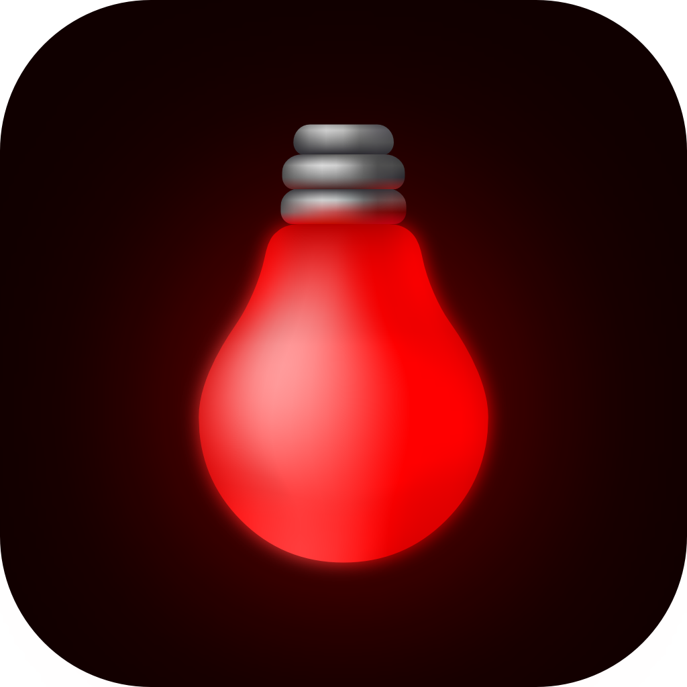
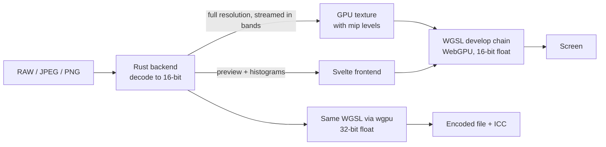

<div align="center">



# Open Darkroom

**An open source darkroom for film scans and digital photos.**

Open the door to your darkroom!\* Ditch the taxes of the monopolists on your photography.
Open a negative, press one button, and get a clean, balanced positive. Then finish it with a full set of develop tools, all rendered on the GPU in real time.

<sub>\* - Not financial advice.</sub>

[](https://github.com/alayshoo/Open-Darkroom/releases/latest)
[](https://github.com/alayshoo/Open-Darkroom/actions/workflows/tests.yml)


[Download](#download) · [Features](#features) · [Build from source](#build-from-source) · [How it works](#how-it-works)

</div>

---

## Automatic negative inversion

Open Darkroom inverts negatives with the same technique as the Hasselblad Flextight scanning software: every colour channel gets its own black point, white point and gamma. Each layer of a colour negative has a different density range on top of the orange film base, so setting the channels separately removes the cast at its source instead of correcting it afterwards.

**It does this for you.** Turn on invert and press auto: Open Darkroom reads the histogram of each channel and places its black and white points to span exactly what the film holds. The orange mask disappears and the colours come out neutral, ready to edit, without sampling the film base or picking a grey point.

- Works on colour and black and white negatives
- Reads only what the crop keeps, so once the film border and sprocket holes are cropped out they can't throw it off
- Every point it sets stays on a slider: fine-tune red, green and blue individually, or all three at once with the master set
- Per-channel histograms sit behind the sliders, so you can see what each one is doing

## Replaces Lightroom plus Negative Lab Pro

Converting film usually means a Lightroom subscription and a paid plugin on top. Open Darkroom does both jobs in one free, open source app: the inversion and the editing that follows it.

It edits regular photos too, so a roll of film and a folder of digital shots go through the same tool.

## Features

### Develop
- **Light:** exposure, contrast, brightness, highlights, shadows, whites, blacks
- **Colour:** white balance (temperature and tint), saturation, vibrance, hue
- **HSL:** hue, saturation and luminance across eight colour bands
- **Curves** editor
- **Detail:** clarity, texture and unsharp masking with luma and detail thresholds

### Workflow
- **RAW support** for the cameras [rawler](https://github.com/dnglab/dnglab) reads, alongside JPEG and PNG
- **Crop** with preset and custom aspect ratios, plus horizontal and vertical flips
- **Presets**, and copy and paste of adjustments between images
- Full **undo and redo** history
- **Loupe** and smooth zoom and pan over the full resolution image
- Rebindable **keyboard shortcuts**

### Colour management
- A wide-gamut **Rec. 2020** working space
- Export to **sRGB, Display P3, Adobe RGB or Rec. 2020**, with the ICC profile embedded
- Soft proofing and a gamut overlay to see what an output space will clip

### Export
| Format | Options |
| --- | --- |
| **TIFF** | 8 or 16 bit |
| **PNG** | Compression level |
| **JPEG** | Quality |
| **WebP** | Lossy or lossless |

Exports run the same shaders as the preview, at full resolution in 32-bit float, so what you see is what you get.

## Download

Grab the latest build from the [**Releases**](https://github.com/alayshoo/Open-Darkroom/releases/latest) page.

| Platform | File | Notes |
| --- | --- | --- |
| **Windows** | `.msi` | Windows may warn the installer is unrecognised: choose *More info*, then *Run anyway*. |
| **macOS** | `.dmg` | Universal, runs on Apple Silicon and Intel. The app is not signed by Apple, so on first launch open *System Settings → Privacy & Security* and choose *Open Anyway*. |

Open Darkroom needs a GPU with **WebGPU** support.

## Build from source

### Prerequisites
- [Node.js](https://nodejs.org/) 22 and [pnpm](https://pnpm.io/)
- [Rust](https://www.rust-lang.org/tools/install) (stable)
- The [Tauri prerequisites](https://v2.tauri.app/start/prerequisites/) for your platform

### Run it

```bash
pnpm install
```

```bash
pnpm tauri dev
```

### Package an installer

```bash
pnpm tauri build
```

### Test

```bash
pnpm test:unit
```

```bash
cargo test --manifest-path src-tauri/Cargo.toml
```

## How it works



- **Opening:** the Rust backend decodes the file into a 16-bit buffer and sends a preview of up to 2048px along with the histograms, so the image appears straight away. The full resolution image then streams to the GPU in bands of rows.
- **Editing:** the develop chain is written in WGSL and runs on WebGPU. It renders only what is on screen, at the resolution the zoom needs, so sliders stay real time on large scans. Zooming and panning never go back to the backend.
- **Exporting:** the backend runs the very same WGSL files through wgpu over the full resolution buffer, then encodes the result.

### Built with

[Tauri 2](https://tauri.app/) · [Svelte 5](https://svelte.dev/) · [WebGPU](https://www.w3.org/TR/webgpu/) · [wgpu](https://wgpu.rs/) · [rawler](https://github.com/dnglab/dnglab) · [Little CMS](https://www.littlecms.com/) · [Tailwind CSS](https://tailwindcss.com/)

## Contributing

Issues and pull requests are welcome. Branch off `main`, which is the nightly build, and open your pull request back into it. The `release` branch is only updated from `main` when a new version ships.

## License

Released under the [MIT License](https://opensource.org/license/mit).
